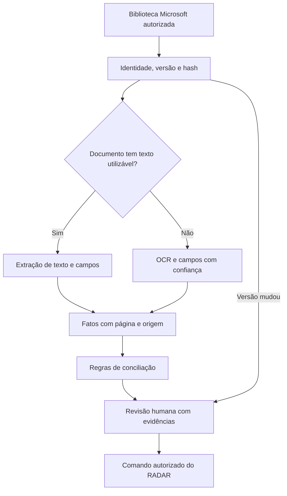

# Inteligência operacional e análise documental assistida

**Data:** 25/11/2026. **Classe:** estudo de viabilidade e prova de conceito; não altera contratos funcionais nem o escopo aprovado de T5. **Base de produto examinada:** `6dd6a9f9f8147deb39c5813baad0b5521427b8bd`.

## 1. Decisão de arquitetura

O primeiro incremento útil é **organizar evidências e preparar correspondências explicáveis para o analista**. O RADAR continua responsável por escola, competência, programa, despesa, Pendência, análise, bonificação e histórico. O processamento documental produz fatos candidatos; sua aprovação precisa passar pelas autoridades existentes do produto.

Esta entrega inclui um [protótipo navegável isolado](../../ops/document-intelligence-poc/index.html), um motor determinístico, fontes inteiramente sintéticas, testes e [consultas agregadas reproduzíveis](../../ops/document-intelligence-poc/operational-indicators.sql). Não há integração Microsoft/OCR/IA implantada. As leituras institucionais reais foram separadas do repositório público: este documento registra método, implicações e desenho, sem valores por escola, pessoas, documentos reais ou credenciais.

## 2. O que a base atual permite afirmar

A análise somente de leitura encontrou registros suficientes para organizar filas por etapa, documento e competência. A concentração de pendências fiscais e de extratos torna esses documentos um bom recorte inicial. Há dois universos provisórios diferentes: a despesa fiscal cuja natureza ainda precisa ser identificada e a saída da conta Qualidade cujo programa ainda precisa ser definido. Seus totais não devem ser somados indiscriminadamente nem descritos como execução financeira confirmada.

A cobertura dos campos estruturados de origem documental é limitada. Isso indica dificuldade de automação com a estrutura atual; **não demonstra que o documento está ausente** do SharePoint, de texto livre, do arquivo da escola ou de outra fonte. Os intervalos de registro de muitas reanálises são muito curtos e não sustentam uma comparação de produtividade entre servidores. A qualidade da medição deve preceder rankings ou metas.

Autoridades existentes reutilizáveis:

| Capacidade | Autoridade já presente | Uso na evolução |
|---|---|---|
| Contexto escolar/mensal/programa | `RadarCompetenceContext`, `verifications`, serviços escolares | Associar uma evidência ao contexto confirmado, sem deduzir competência da data do pagamento |
| Despesa individual | `InvoiceService` e RPC fiscal vigente | Preparar campos; salvar somente pelo comando autorizado e idempotente |
| Origem de novo envio | `pendency_attempts.drive_url`, ponte de estado | Evoluir para referência versionada preservando o significado do link atual |
| Próxima ação | `src/domain/operational-projection.js` | Reutilizar os dois relógios: antiguidade histórica e espera da etapa corrente |
| Análise fiscal individual | `src/domain/invoice-document-analysis.js` | Preservar o tratamento explícito dos legados sem análise individual |
| Autoria e histórico | Registros administrativos e contrato de correção | Registrar aceitação/rejeição humana sem fabricar uma decisão institucional |

O fluxo documental atual foi descrito pelo proprietário. Não foram examinadas pastas ou amostras reais do Microsoft 365 nesta rodada. Estrutura de bibliotecas, permissões, formatos, qualidade de digitalização e tempo humano atual ainda precisam ser medidos num piloto autorizado.

## 3. Indicadores que ajudam a decidir

| Indicador | Denominador e leitura | Decisão apoiada | Limite |
|---|---|---|---|
| Fila pronta para reanálise | Pendências em Aguardando reanálise, separadas das Abertas | Distribuir trabalho interno que já pode avançar | Contagem não mede complexidade do caso |
| Antiguidade histórica do passivo | Pendências ativas com `opened_at` válido; mediana e P90 | Localizar acúmulo e avaliar cobertura de acompanhamento | Não equivale ao tempo da ação atual; reaberturas preservam a origem |
| Despesas a identificar | Quantidade/valor dessa natureza dentro das despesas registradas | Organizar busca documental e identificação | Valor provisório não equivale a gasto validado; legados são preservados |
| Saídas Qualidade sem programa | Movimentações `open`, apresentadas separadamente das NFs | Identificar o programa antes de lançar/conciliar a despesa | A identificação pode vincular a uma NF; evitar dupla contagem |
| Cobertura de fontes verificáveis | Registros com referência estruturada, versão e trecho/âncora | Definir onde a automação pode ajudar | Campo vazio não prova documento faltante |
| Duração de resolução | Intervalos cronologicamente válidos entre abertura e resolução | Dimensionar acompanhamento do passivo | Separar coortes e excluir intervalos inválidos explicitamente |
| Inventário por etapa | Bens registrados Não encaminhada/Encaminhada/Inventariada | Identificar a etapa que acumula trabalho | O RADAR não substitui SIGMA nem prova inventariação externa |
| Consolidação por contexto existente | Bonificações consolidadas / contextos já registrados | Encontrar trabalho de fechamento dentro do universo observado | Não é percentual de escolas regulares nem cobertura obrigatória de programas |

O SQL versionado calcula esses agregados sem retornar nomes, IDs de escolas, responsáveis, números de notas ou textos livres. Os resultados reais foram entregues separadamente ao proprietário. A matriz de integridade já validada na publicação foi reutilizada; esta pesquisa não repete migrations, backup ou homologação institucional.

## 4. Arquitetura progressiva

### 4.1 Origem Microsoft e permissões

O vínculo deve usar `siteId`, `driveId`, `itemId` e uma versão, acompanhados do hash do conteúdo efetivamente analisado. A associação pasta → escola/mês/programa começa com confirmação humana. O nome de arquivo ajuda a sugerir contexto; não o torna autoridade.

O Microsoft Graph oferece permissões selecionadas para sites, listas, itens, pastas e arquivos. Consentimento em Entra ID, concessão explícita ao recurso e token adequado são requisitos distintos. O desenho proposto começa com leitura de um conjunto de recursos aprovado; não pede escrita documental. A escolha entre fluxo delegado e aplicativo depende do tenant e do trabalho em segundo plano. A compatibilidade de cada endpoint com o escopo escolhido deve ser demonstrada no piloto, sem ampliar permissões automaticamente. [S1]

Para recursos autorizados, `delta` pode manter um índice de alterações com paginação e cursor. A resposta representa o estado mais recente, não cada evento histórico. Um arquivo removido deixa de estar disponível como fonte corrente; sua remoção não apaga a decisão já tomada no RADAR. Reprocessamento e revisão devem preservar o vínculo à versão anterior. [S2]

URLs de download são temporárias e pré-autenticadas. Servem ao transporte imediato, não à identidade persistente da evidência; ficam fora de logs e históricos públicos. O serviço deve tratar `429` com `Retry-After` e usar acompanhamento incremental para reduzir leituras repetidas. [S3, S4]

### 4.2 Extração proporcional ao documento

PDF com texto e formatos estruturados podem começar com extração convencional. Imagem digitalizada requer OCR; tabelas bancárias precisam preservar linha, sinal, moeda e relação com saldo. O modelo de invoices do Document Intelligence retorna campos estruturados e atende documentos como faturas e contas de serviços. O suporte a português inclui Brasil; isso não certifica a leitura de cada layout de nota, extrato ou comprovante usado pela instituição. O modelo específico `prebuilt-bankStatement` lista inglês dos Estados Unidos: seu suporte não deve ser presumido para os extratos brasileiros do projeto. Para esses arquivos, extração de layout/tabelas e regras próprias precisam ser avaliadas no piloto. [S5, S6]

Um piloto deve avaliar acerto **por campo**: valor, número, beneficiário, data e moeda. Confiança de OCR/extração auxilia a seleção para revisão; não comprova autenticidade fiscal ou regularidade administrativa. Campos sem confiança ou sem âncora também entram em revisão. O limiar deve ser calibrado em amostras representativas, sem transportar o número ilustrativo da POC para produção. [S7]

IA generativa pode ajudar na classificação de documentos heterogêneos e no resumo fundamentado de textos. Conciliação de valores, igualdade de identidades, controle de versão e regras aprovadas ficam em código determinístico. Texto de documentos é dado externo, inclusive quando contém comandos dirigidos a um assistente; não pode autorizar acesso, operação no RADAR ou chamada de ferramenta.

### 4.3 Fatos, sugestões e decisões distintos

| Tipo | Exemplo | Autoridade |
|---|---|---|
| Informação extraída | Valor lido na página 2, com trecho e confiança | Fonte documental versionada; sujeito a erro de extração |
| Informação registrada | Valor informado pelo usuário no RADAR | Registro canônico com autoria/versão |
| Regra determinística | Referência, beneficiário e valor coincidem | Regra explícita e versionada |
| Inferência de IA | Documento provavelmente pertence a uma categoria | Hipótese identificada como tal |
| Sugestão de análise | Conferir diferença de R$ X entre dois documentos | Proposta acompanhada das duas fontes |
| Pendência validada | Analista confirma falha documental | Comando autorizado do domínio |
| Decisão administrativa | Conclusão aprovada no fluxo institucional | Pessoa e competência institucional aplicáveis |

A revisão mostra lado a lado o dado existente, o candidato e a fonte. Uma sugestão aceita continua sujeita às versões esperadas e capacidades do usuário. Se documento ou registro mudar, a proposta precisa ser reconstruída. Ausência de correspondência na amostra consultada deve ser chamada assim; não vira automaticamente “pagamento sem documento”.

## 5. Prova de conceito entregue

A [POC](../../ops/document-intelligence-poc/README.md) contém cinco situações: correspondência compatível; diferença de valores; dois pagamentos possíveis; coincidência somente por valor; extração incerta. Mostra as fontes fictícias, seu conteúdo, versão e hash. A revisão simulada fica apenas na memória da página.

O motor verifica os bytes das fontes por SHA-256, usa centavos inteiros e exige identidade de contexto, referência, beneficiário e moeda. Avalia disputas entre todas as notas antes de alocar pagamentos, evitando um pareamento ganancioso dependente da ordem. A revisão recusa fontes alteradas depois da sugestão. Nenhum resultado automático recebe conclusão administrativa.

Foram executados 12 testes de comportamento, incluindo contraprovas de contexto, moeda, crédito bancário, ausência de proveniência, inferência de IA, fonte adulterada, versão obsoleta e pagamento disputado. Um E2E adicional percorre as cinco situações, confere a revisão em memória e produz capturas em 1440 e 390 pixels no workflow Playwright já existente. A tela está pronta para inspeção visual no ambiente de homologação. A ausência do Chromium no executor local impede declarar validação visual local; os testes do motor não substituem essa inspeção. A entrega também pode ser empacotada em HTML autossuficiente, com o mesmo motor e as mesmas fontes fictícias.

Não foram implementados OCR, autenticação Microsoft, acesso a bibliotecas, conciliação de parcelas/retenções, detecção de fraude, gravação no RADAR ou um modelo de IA. Esses limites são apresentados também na demonstração.

## 6. Oportunidades priorizadas

### P1 — Fila de trabalho por próxima ação, com os dois relógios

**Problema e experiência atual:** documentos já reenviados competem visualmente com passivos que ainda dependem da escola; idade total e espera corrente podem ser confundidas. **Solução:** tornar reanálise pronta e espera da escola dois recortes explícitos, mantendo o histórico ao abrir o item. **Benefício:** iniciar pelo trabalho executável sem perder os casos antigos. **Viabilidade/complexidade:** alta/baixa a média, reutilizando a projeção operacional e filtros existentes. **Risco/dependência:** preservar a diferença deliberada de relógios; não inventar SLA ou ranking. **Relação com T5:** a futura edição de tentativas precisa recalcular a etapa corrente sem reescrever a abertura original.

### P1 — Continuidade de contexto entre despesa, pendência e evidência

**Problema e experiência atual:** o analista reconstrói o contexto ao alternar entre documento externo, nota e pendência. **Solução:** um conjunto de referências do item com retorno à origem, contexto sempre visível e indicação de fonte ainda não verificada. **Benefício:** reduzir redigitação e associação ao mês/programa errado. **Viabilidade/complexidade:** alta/média na UI já existente; o vínculo Microsoft é etapa posterior. **Risco/dependência:** um link não é prova de documento nem dá permissão de acesso. **Relação com T5:** conservar vínculo individual em tentativa, reanálise e histórico.

### P1 — Medição com cobertura e qualidade explícitas

**Problema e experiência atual:** totais e durações podem aparentar cobertura completa ou produtividade real. **Solução:** cada indicador informa universo, campos ausentes, exclusões de qualidade e data de referência; o detalhamento abre os registros que compõem o número. **Benefício:** decisões gerenciais sustentadas por dados interpretáveis. **Viabilidade/complexidade:** alta/média com agregados existentes. **Risco/dependência:** evitar ranking de pessoas; dados importados/retroativos exigem coortes. **Relação com T5:** correções históricas não devem reescrever retroativamente o significado das medições sem proveniência.

### P2 — Caixa de conciliação documental assistida

**Problema e experiência atual:** localizar e comparar números/valores consome atenção. **Solução:** apresentar candidatos de correspondência com evidências; ambiguidades e valores divergentes ficam para revisão. **Benefício:** reduzir busca repetida e expor o raciocínio. **Viabilidade/complexidade:** técnica comprovada parcialmente pela POC; integração média a alta. **Risco/dependência:** permissões Microsoft, avaliação da extração e tratamento de parcelas/retenções. **Relação com T5:** aprovação gera apenas comandos canônicos com autoria, versão e histórico granular.

### P2 — Visão de pendências derivadas da mesma causa documental

**Problema e experiência atual:** uma falha de envio pode afetar múltiplos registros; a contagem de pendências não revela o esforço de correção. **Solução:** sugerir agrupamentos por fonte/versão e contexto, mantendo cada pendência individual. **Benefício:** orientar uma solicitação objetiva e identificar quais registros aguardam o mesmo documento. **Viabilidade/complexidade:** média; depende da melhoria da proveniência. **Risco/dependência:** agrupamento não resolve pendências em lote nem mistura dimensões fiscais/Assessoria. **Relação com T5:** preserva tentativas e decisões individuais.

### P2 — Conferência patrimonial com a despesa de origem acessível

**Problema e experiência atual:** a fila patrimonial pode exigir navegar para reencontrar a NF e o contexto. **Solução:** destacar estado patrimonial, origem fiscal e próximo passo com navegação contextual. **Benefício:** reduzir reconstrução manual do vínculo. **Viabilidade/complexidade:** alta/média usando ligações existentes. **Risco/dependência:** a situação no SIGMA não pode ser inferida; inconsistências preexistentes exigem conferência documental. **Relação com T5:** preparar a retificação granular e o histórico aprovados, sem implementar regras futuras por antecipação.

Não se propõe criar outra busca global, outro Dashboard ou uma segunda autoridade de análise. As superfícies existentes já oferecem essas funções; a evolução concentra-se na ligação entre fatos, origem e próxima ação.

## 7. Sequência de implantação e custo

1. **Agora:** usar a POC sintética e os indicadores para validar utilidade e linguagem. Nenhum acesso externo novo é necessário.
2. **Piloto de leitura autorizado:** escolher biblioteca/recorte, confirmar permissões, mapear contextos e medir a qualidade dos documentos. Estabelecer amostra humana de referência.
3. **Extração e comparação assistidas:** extrair campos, confrontar fontes e medir precisão por campo, falso pareamento, proporção de revisão e tempo humano por tarefa comparável.
4. **Integração ao RADAR:** conectar sugestões aprovadas aos comandos vigentes, com Auth/capacidade, concorrência, idempotência e autoria. Esta etapa exige decisão própria; a POC não a autoriza.

O custo deve ser estimado a partir de páginas realmente processadas, tipo de extração, armazenamento temporário, reprocessamentos por nova versão e revisão humana. Document Intelligence cobra por páginas analisadas; selecionar páginas e reaproveitar resultado da mesma versão evita cobrança repetida. A tabela oficial depende de região, moeda e oferta; não foi obtida cotação institucional e não se apresenta preço inventado. [S8]

Uma avaliação de ganho deve comparar tarefas e documentos semelhantes antes/depois. Medianas de timestamps administrativos atuais não são uma linha de base suficiente. O piloto será útil se reduzir o tempo de conferência sem aumentar falsos pareamentos e sem esconder a necessidade de revisão.

## Fontes oficiais consultadas em 25/11/2026

- **S1:** [Microsoft Graph — Selected permissions](https://learn.microsoft.com/en-us/graph/permissions-selected-overview).
- **S2:** [Microsoft Graph — driveItem delta v1.0](https://learn.microsoft.com/en-us/graph/api/driveitem-delta?view=graph-rest-1.0).
- **S3:** [Microsoft Graph — Download driveItem content](https://learn.microsoft.com/en-us/graph/api/driveitem-get-content?view=graph-rest-1.0).
- **S4:** [Microsoft Graph — throttling guidance](https://learn.microsoft.com/en-us/graph/throttling).
- **S5:** [Document Intelligence — invoice model v4.0](https://learn.microsoft.com/en-us/azure/ai-services/document-intelligence/prebuilt/invoice?view=doc-intel-4.0.0).
- **S6:** [Document Intelligence — language support](https://learn.microsoft.com/en-us/azure/ai-services/document-intelligence/language-support/prebuilt?view=doc-intel-4.0.0).
- **S7:** [Document Intelligence — accuracy and confidence](https://learn.microsoft.com/en-us/azure/ai-services/document-intelligence/concept/accuracy-confidence?view=doc-intel-4.0.0).
- **S8:** [Azure — Document Intelligence pricing](https://azure.microsoft.com/en-us/pricing/details/document-intelligence/).

O desenho e as prioridades acima são uma proposta de engenharia aplicada ao RADAR, não uma recomendação institucional da Microsoft nem uma confirmação de permissões do tenant.
