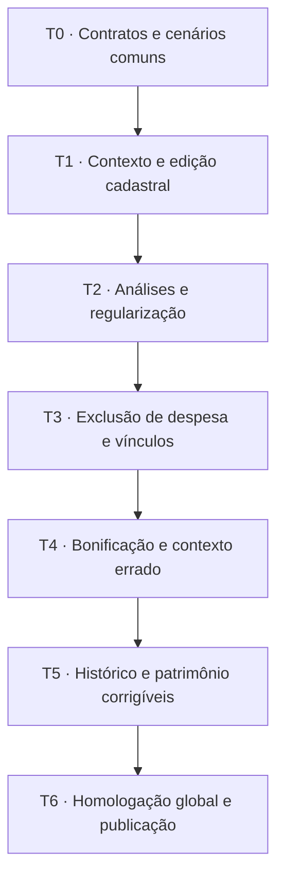

# Prontuário: design, correção e exclusão integrados — plano de implementação

> **Para execução por agentes:** ler as duas especificações e este plano inteiro antes de executar uma tarefa. Usar `superpowers:executing-plans` ou, se escolhido pelo proprietário, `superpowers:subagent-driven-development`. Os passos `- [ ]` registram trabalho futuro, não concluído. Este pedido autoriza análise e planejamento; não inicia implementação, migration, merge ou deploy.

**Objetivo:** tornar a avaliação escolar mais bonita, compreensível e fácil de corrigir, com liberdade de edição/exclusão e integridade de todos os efeitos relacionados.  
**Arquitetura:** evoluir a matriz de avaliação por programa e suas superfícies contextuais, conservando as autoridades de domínio existentes. Acrescentar comandos transacionais de correção/exclusão com alcance calculado no servidor, projeção visual do impacto e reconciliação de todas as superfícies afetadas. Entregar jornadas completas, integrando apresentação, operação, persistência e releitura no mesmo lote.  
**Tecnologias:** JavaScript/DOM e CSS existentes; Node 24; Supabase/PostgreSQL/Auth/RLS/RPC; Vercel; node:test, Playwright e pgTAP já adotados. Sem troca de framework, biblioteca visual ou atualização de dependências nesta frente.  
**Baseline confirmada em 14/11/2026, Brasília:** `main@190e44942d0bb6927d1a7eeb83fb94fc782171b8`; comparação remota idêntica durante o planejamento. Os catálogos SQL abaixo são evidência datada da análise anterior, não revalidação automática de futuras migrations.  
**Estado:** plano proposto, sem etapas de implementação executadas.

**Especificações que acompanham o plano:**

- [Direção visual do Prontuário, documento fixado](https://github.com/WilsonMPeixoto-2/RADARPDDE/blob/5e57eda0e47983754b54b3ee1f7c59ecba202dbd/docs/superpowers/specs/2026-11-13-prontuario-exploracao-visual.md).
- [Análise de flexibilização aprovada como direção pelo proprietário](https://github.com/WilsonMPeixoto-2/RADARPDDE/blob/5db04f4779a717b7bd11b948c293d086f97764b3/docs/superpowers/specs/2026-11-14-flexibilizacao-correcao-exclusao-lancamentos.md).
- [Evidências de FKs, triggers, políticas, funções e contagens](https://github.com/WilsonMPeixoto-2/RADARPDDE/blob/5db04f4779a717b7bd11b948c293d086f97764b3/docs/evidence/2026-11-14-flexibilizacao-lancamentos-catalogo.json).

## Restrições globais

- Bonificação, análise técnica, Pendência, Assessoria e inventário são dimensões relacionadas, mas não uma sequência obrigatória de aprovação.
- Despesa/análise técnica não reabre nem limpa bonificação consolidada. Correção da própria bonificação ou exclusão explícita do pacote pode fazê-lo.
- NF e Assessoria operam por `registered_invoice_id`. NF A não bloqueia nem altera NF B.
- `a_identificar` nasce Incorreto + Pendência atomicamente. Saída provisória do Qualidade não é NF/Pendência antes da identificação.
- Observações e justificativas de correção são opcionais; nenhum checkbox declaratório ou texto adicional obrigatório para liberar edição/exclusão.
- Carteira, autor original e CRE não viram restrições de colaboração. Capacidade operacional e autoridade autenticada continuam necessárias.
- Perfis Controlador, Assistente e Administrador Técnico podem operar o conjunto fiscal autorizado; permissão de Inventário não concede automaticamente exclusão fiscal.
- Supabase continua fonte canônica; memória local é projeção descartável. Não mascarar falha remota com sucesso local.
- Manter busca, exercício, navegação, alertas, guia, contatos, comunicação, histórico, inventário, exportações e demais funções existentes. Reduzir sua proeminência não significa removê-las.
- Preservar desktop prioritário em 1280×720, 1440×900 e 1920×1080 CSS px; manter compatibilidade responsiva dos componentes compartilhados, sem abrir projeto paralelo de redesign mobile.
- Referência visual não cria enum, campo obrigatório, regra de negócio ou aprovação que o sistema não possua.
- Não resolver falha de teste enfraquecendo regra válida, tolerância visual ou autorização. Contratos antigos deliberadamente substituídos recebem novos testes explícitos.
- As contagens anteriores — inclusive 424 despesas com histórico e dois legados sem FK individual — não autorizam limpeza em massa nem indicam que os registros são inválidos.

## Foco da revisão e prova correspondente

| Condição que costuma escapar ao caminho ideal | Comportamento esperado | Tarefa responsável |
|---|---|---|
| Um colega cria dependente enquanto outro confirma exclusão; aba antiga repete gravação | Nada novo é apagado sem estar no alcance confirmado; nada excluído reaparece por retry | T2/T3, teste `concurrent-child-and-stale-retry` |
| Pendência antiga sem NF individual ou histórico legítimo do mesmo documento | Não inferir causalidade por texto/contexto amplo; oferecer alvo explícito | T2/T4, `legacy-scope-does-not-consume-independent-history` |
| NF válida coexistindo com marca N/A e bonificação consolidada | Correção da marca não apaga NF nem aprova análise fiscal automaticamente | T4, `na-bonus-with-valid-invoices` |
| Extensão crítica ainda não carregou, sessão foi recriada ou regra nova não está no backend | Não gravar Incorreto sem Pendência nem executar fallback destrutivo; orientar atualização sem travar consulta | T1/T2/T6, `late-bootstrap-and-old-client` |
| Nome/erros muito longos, várias NFs, zoom 200%, teclado e dark theme | Contexto, conteúdo e ações continuam legíveis, alcançáveis e inequívocos | T1/T5/T6, `dense-context-keyboard-theme` |

## 1. Estratégia de integração

Foram consideradas três formas de entrega:

| Abordagem | Consequência | Decisão deste plano |
|---|---|---|
| Concluir todo o visual e só depois flexibilizar regras | Refaz formulários/estados; pode publicar botões elegantes que continuam bloqueados | Não adotar |
| Reescrever interface e regras em um único lote | Dificulta localizar regressão e verificar causalidade; aumenta o risco de reversão ampla | Não adotar |
| Entregar jornadas completas, com contrato comum e revisão global | Cada lote produz interface e comportamento coerentes; dependências são testadas antes da exposição | **Recomendação adotada para o planejamento** |

“Concomitante” significa que os dois objetivos evoluem dentro de cada jornada, não que vários agentes devam editar ao mesmo tempo as mesmas autoridades. Lotes podem ter commits pequenos, mas só se tornam candidatos de publicação quando interface, serviço, SQL, permissões e efeitos daquele lote estiverem completos.

Recomendação de execução: uma frente de integração cumulativa, com checkpoints por tarefa e Preview do mesmo candidato. Evitar branches de design e de regras que só se encontrem no merge final. A publicação padrão ocorre após T6; uma publicação parcial exige delimitar um subconjunto integralmente funcional e executar seus gates globais, sem apresentar a flexibilização inteira como concluída.

O proprietário aprovou a direção das análises. Este plano organiza sua execução e faz escolhas técnicas propostas, sem afirmar aprovação prévia de cada assinatura de API ou de cada valor visual.



## 2. Reconciliação dos dois estudos: precedência explícita

O estudo visual descrevia o contrato funcional anterior. As partes abaixo são substituídas pela direção de flexibilização, não carregadas como obrigações para a implementação.

| Descrição anterior | Contrato combinado |
|---|---|
| Retificação exige justificativa, declaração e deixa Pendência Cancelada | Correção sem narrativa obrigatória; remover o erro e seus dependentes quando esse for o alcance escolhido. Cancelar um problema real continua ação distinta |
| Observação obrigatória no novo envio | Observação opcional; data de disponibilização continua dado de negócio |
| Exclusão só sem histórico e sem patrimônio terminal | Exclusão composta disponível com histórico e patrimônio, sob capacidade e integridade do conjunto |
| Inventariada é absolutamente imutável | Ciclo ordinário protegido; correção explícita pode desfazer o lançamento equivocado e seus efeitos |
| Restrições atuais da bonificação permanecem todas | Operador pode corrigir lançamento consolidado; reabrir somente a bonificação afetada quando pertinente |
| Imagem de retificação contém campos obrigatórios antigos | Preservar hierarquia e comparação Antes → Depois; substituir campos/CTAs pelo novo comportamento |
| Uniformizar todos os seletores | Uniformizar aparência; opções continuam específicas, sem N/A artificial para documentos obrigatórios |
| Régua mensal como semáforo geral | Mostrar separadamente estado da bonificação e quantidade de Pendências; não fundir em “escola aprovada” |

A referência continua sendo a matriz por programa, contexto compacto, faixas informativas e detalhe contextual. As seis pranchas anteriores não servem para reintroduzir bloqueios superados. Antes de aceitar fidelidade visual, conferir o conteúdo funcional apresentado por cada prancha contra este plano.

## 3. O contrato que une visual e comportamento

Cada operação deve responder às mesmas perguntas, no mesmo contexto: **qual objeto**, **qual situação**, **qual ação**, **o que muda**, **o que permanece** e **qual resultado foi confirmado**.

| Jornada | Expressão visual | Efeito de negócio | Prova posterior |
|---|---|---|---|
| Editar número/valor/descrição | Editor leve, dados de identidade visíveis, observações opcionais | Mesmo ID, vínculos preservados, bem derivado atualizado quando pertinente | Reload e tela de Inventário |
| Registrar Incorreto | Formulário de apontamentos + efeito resumido | Análise e Pendência atômicas | Pendências e Prontuário concordam |
| Registrar novo envio | Data, link e observações; previsão Aguardando reanálise | Nova tentativa; não resolve | Histórico e próximo ator coerentes |
| Reanalisar | Evidência e decisão lado a lado; três resultados sem pré-seleção | Última tentativa válida; atraso calculado conforme regra vigente | Análise, Pendência e erros atuais concordam |
| Corrigir avaliação errada | Antes → Depois + dependentes reais atingidos | Correção direta; não simular envio/reanálise | Erro removido sem apagar história independente |
| Excluir despesa | Confirmação única com contagens reais do alcance | NF e dependentes corretos removidos na mesma transação | Ausência do conjunto e presença dos vizinhos |
| Corrigir contexto errado | Escola/mês/programa destacados e ação Excluir lançamentos deste programa neste mês | Remover pacote exato; novo cadastro usa novo contexto/IDs | Outros meses/programas intactos |

### Interfaces propostas, a criar na T2

Não existem ainda. São limites entre módulos para que os lotes conversem sem novos wrappers concorrentes.

`OperationalCorrectionService.preview(request) -> Promise<ChangePlan>` e `OperationalCorrectionService.apply({request, planDigest, operationKey}) -> Promise<ChangeReceipt>`.

`request` tem `contractVersion: 1`, `action`, `target`, `changes?`, `selectedPendencyIds?` e `note?`. `target` contém `kind`, `id?`, `schoolId`, `competence`, `programId?`, `documentKey?`. IDs, contexto e seleção são validados no servidor; não autorizam por si só. `note` admite vazio/null. `changes` é validado por ação, com campos permitidos, e nunca um patch arbitrário de tabela.

Ações a habilitar por lote:

- T2: `correct_analysis`, `clear_analysis`, `delete_pendency`.
- T3: `delete_invoice`, `undo_quality_identification`, `delete_quality_movement`.
- T4: `correct_bonification`, `clear_item_history`, `delete_context`.
- T5: `delete_attempt`, `delete_review`, `correct_attempt`, `correct_review`, `delete_contact`, `correct_contact`, `correct_inventory`, `delete_asset`.

`ChangePlan` contém `contractVersion`, `action`, contexto confirmado, `targets` (tipo/ID/versão), `effects` (excluir/atualizar/reabrir), contagens por tipo, objetos preservados relevantes e `planDigest`. O digest cobre ação, contexto, valores propostos, IDs, versões e efeitos; não é credencial. O cliente não pode acrescentar IDs fora do plano para ampliar a exclusão.

`ChangeReceipt` contém `operationKey`, `committed: true`, `deletedIdsByEntity`, `updatedEntities`, `changedEntities`, `affectedContexts`, `auditId` e `contractVersion`. O catálogo de nomes de entidades deve reutilizar `repository-contract.js`; a provisória deve ter adaptação explícita, pois sua hidratação hoje é separada.

RPCs propostas: `preview_operational_change(p_request jsonb) returns jsonb` e `apply_operational_change(p_request jsonb, p_plan_digest text, p_operation_key uuid) returns jsonb`. A fachada despacha para operações específicas; não se torna CRUD universal. O servidor calcula o plano e o revalida ao executar. Erro por alcance/versão alterados devolve conflito e exige apresentação do novo alcance, sem repetir automaticamente uma exclusão maior.

Edições cadastrais simples permanecem em `InvoiceService.save` e autoridades equivalentes. Não passam por confirmação extra. `InvoiceService.remove` passa a delegar para a autoridade composta ao final da T3; não manter dois caminhos de exclusão com regras diferentes. Operações normais de abertura, envio e reanálise continuam nas autoridades existentes, ajustadas para campos opcionais e serialização comum.

## 4. Mapa de arquivos e responsabilidades

| Área | Arquivos existentes envolvidos | Mudança delimitada |
|---|---|---|
| Renderização e formulários | `app.js`, `index.html`, `src/integration/prontuario-operational-ux.js` | Cabeçalho de programa, contexto, controles e entradas das ações; sem copiar regras SQL para o DOM |
| Estilo | `src/styles/prontuario-operational-ux.css`, `src/styles/evaluation-retification-ui.css`, `src/styles/quality-provisional.css`, `styles.css` | Tokens locais, família de formulários, estados e foco; não sobrescrever indiscriminadamente outras telas |
| Bootstrap e reconciliação | `src/integration/product-extensions-bootstrap.js`, `prontuario-conditional-reconciler.js`, `prontuario-scroll-preservation.js`, `operational-realtime-invalidation.js` | Ordem de instalação, handlers únicos, retorno de foco, respostas antigas e invalidação escolar |
| Autoridades de avaliação | `src/application/verification-service.js`, `src/integration/evaluation-retification.js`, `evaluation-retification-ui.js`, `src/domain/retificacoes.js`, `fluxo-operacional.js` | Novas permissões de correção, efeitos da bonificação e linguagem sem burocracia |
| NF, Assessoria, Pendência | `src/application/invoice-service.js`, `pendency-service.js`, `src/domain/invoice-effects.js`, `pendencias.js`, `src/integration/auditable-retification.js`, `invoice-history-lock.js`, `atomic-analysis-pendency.js`, `service-advisory-pendency.js`, `service-advisory-corrective-submission.js` | Retirar bloqueios superados nas autoridades corretas; manter individualização e ciclo normal |
| Inventário e provisória | `src/application/inventory-service.js`, `src/integration/quality-provisional-ux.js` | Correção patrimonial explícita e inversão da identificação |
| Persistência/projeções | `src/data/supabase-repository.js`, `repository-contract.js`, `state-bridge.js`, `legacy-state-adapter.js`, `src/application/data-service.js`, `state-port.js` | Chamadas RPC, receipt, remoções, payloads e releitura sem ressurreição |
| Novos módulos focados | `src/application/operational-correction-service.js`, `src/integration/operational-correction-ui.js`, `src/domain/pendency-correction.js` | Orquestração, apresentação do impacto e recomposição de tentativas, respectivamente |
| SQL e tipos | Novas migrations aditivas em `supabase/migrations/`; `src/types/database.types.ts` | RPCs, capacidades, bloqueios, guards e contratos. Não reescrever migrations já aplicadas |

Nomes SQL propostos para os lotes: `20261114000100_operational_correction_contract.sql`, `20261114000200_invoice_causal_deletion.sql`, `20261114000300_bonus_context_correction.sql`, `20261114000400_history_inventory_correction.sql`. Na execução, escolher timestamps posteriores à última migration real e atualizar os caminhos no registro do lote; não inserir migrations retroativas se a main tiver avançado.

## 5. Tarefas e critérios de passagem

### T0 — Fixar o contrato combinado e os cenários de referência

**Entrega:** referência funcional/visual reproduzível para todos os lotes. Nenhuma tela fictícia é considerada prova de persistência.

**Arquivos:** criar `docs/reference/PRONTUARIO_CORRECAO_CONTRATO.md`, `tests/fixtures/prontuario-correction-cases.json` e `docs/evidence/prontuario-correcao-integrada/README.md`; conferir `AGENTS.md`, referências canônicas e ADR-055/056. Esses arquivos serão criados na implementação, não nesta etapa documental.

**Interface produzida:** catálogo de casos com `caseId`, contexto, perfil, entidades iniciais, operação, entidades esperadas após, IDs preservados e estados visuais. Casos sintéticos estáveis, isolados por teste; nenhum dado institucional copiado.

- [ ] Revalidar SHA de main, PRs em andamento que toquem os mesmos módulos e funções/políticas SQL ativas; comparar com as duas especificações. Registrar diferenças antes de implementar.
- [ ] Mapear cada entrada de UI até serviço/RPC/consumidores, incluindo escrita direta por REST, instalação tardia e recriação de serviços após autenticação. Assinalar qual autoridade será alterada e qual permanece.
- [ ] Montar casos: NF A/B, serviço com Pendência fiscal e Assessoria, permanente inventariada, a identificar, provisória aberta/identificada, verificação N/A/consolidada, Pendência legada sem FK, vários envios e histórico anterior válido.
- [ ] Capturar estados atuais com código real: grade, detalhe, Incorreto, novo envio, reanálise, correção, contatos e Capital. Armazenar viewport, tema, perfil, contexto e SHA.
- [ ] Definir a composição de referência dos mesmos estados com as regras novas, incluindo correção/exclusão. Usar protótipo com renderizadores reais e fixture; não fingir Supabase num modo local.
- [ ] Conferir que cada cenário possui alvos removidos **e** vizinhos que precisam permanecer; conferir que toda exigência de ambos os estudos aparece neste plano ou na tabela de substituições.
- [ ] Registrar commit de contrato/fixtures com o estado “referência, não homologação funcional”.

**Gate T0:** nenhum conflito funcional pendente entre desenho e regras novas; referência contém todas as ações existentes e as novas, sem aprovação geral inventada. Casos conhecidos possuem resultado esperado verificável, inclusive os legados.

### T1 — Contexto visual e edição cadastral de ponta a ponta

**Entrega:** Prontuário mais legível, com edição já permitida funcionando no novo desenho.

**Arquivos:** modificar renderização/estilo/bootstraps do mapa; conservar `InvoiceService.save` e `auditable-retification.js`. Criar `tests/e2e/prontuario-correction-layout.spec.js`; ampliar `tests/e2e/invoice-retification-projections.spec.js` e `prontuario-scroll-preservation.spec.js`.

**Consome:** casos T0 e autoridades existentes. **Produz:** componentes/contexto usados pelos formulários T2–T5; nenhuma nova autoridade de negócio.

- [ ] Acrescentar teste `same-invoice-metadata-edit-with-active-pendency`: mesma NF e Pendência após salvar; valor/número/descrição do bem derivado atualizados; NF B e bonificação idênticas.
- [ ] Acrescentar teste `dense-context-keyboard-theme`: contexto visível, campos/ações alcançáveis, Escape e retorno de foco; texto longo integralmente consultável.
- [ ] Executar os novos cenários para distinguir comportamento já existente de apresentação ainda ausente. Não exigir falha artificial quando a regra funcional já passa.
- [ ] Aplicar cabeçalho compacto e horizontal por programa, colunas Documento/Bonificação/Análise/Providência, seleção perceptível além da cor e identidade antes de cada editor. Preservar ordem dos programas e `RadarCompetenceContext`.
- [ ] Substituir a dependência de `td[rowspan]` de `getProgramGroups` por agrupamento semântico por programa, atualizando consumidores no mesmo lote. Não remover a célula e deixar integração inferindo grupos antigos.
- [ ] Aplicar a direção de arte: branco quente `#FAFAFC`, tinta `#252133`, secundário `#686477`, roxo `#6335B5`; Outfit/Plus Jakarta existentes; títulos 24–28 px, seções 18–20 px, corpo 14–16 px; escala 4/8/12/16/24/32; controles 36–40 px e números monetários tabulares. Sombra apenas para superfícies sobrepostas. Medir contraste nos pares finais e adaptar tokens existentes no dark theme.
- [ ] Mostrar resumos separados de bonificação e análise; régua mensal com rótulo/contagem, sem leitura global falsa. Cards flutuantes são apoio por foco/clique; informação essencial permanece visível.
- [ ] Conferir editar/salvar/recarregar com NF com Pendência; nenhum duplo listener, scroll perdido ou formulário fechado por atualização concorrente.
- [ ] Executar os testes focalizados e capturar comparação antes/depois nos três viewports. Registrar commit do lote com evidência visual e funcional.

**Gate T1:** usuário identifica escola/mês/programa e encontra edição; dados persistem após reload; nenhum controle existente desapareceu. Novos comandos destrutivos ainda não aparecem como funcionais antes das tarefas correspondentes.

### T2 — Correção de análises integrada ao ciclo normal de Pendências

**Entrega:** abrir, enviar, reanalisar e corrigir usam a mesma linguagem visual; corrigir um erro não exige simular regularização.

**Arquivos:** criar serviço/UI de correção e migration de contrato; modificar autoridades de avaliação/Pendência/Assessoria, repositório, bootstrap e tipos do mapa. Criar `supabase/tests/database/operational-correction.test.sql`, `tests/unit/operational-correction-service.test.js` e `tests/e2e/prontuario-analysis-correction.spec.js`.

**Consome:** contexto T1 e fixtures T0. **Produz:** interfaces de preview/apply/receipt da seção 3, disponíveis para T3–T5. Registrar o serviço em `RadarApplicationServices` pelo ponto de composição existente; não instalar uma segunda cadeia de interceptações sobre handlers.

- [ ] Criar testes de abertura Incorreto + Pendência atômica, cancelamento do formulário sem escrita, envio sem resolução e três resultados de reanálise. Comparar estado de bonificação antes/depois.
- [ ] Criar teste de correção atual com Pendência equivocada e histórico legítimo anterior: excluir apenas a consequência identificada, preservar NF e histórico independente. Se a origem for ambígua, exigir alvo explícito, nunca consumir todo o contexto.
- [ ] Criar testes de nota vazia em UI/domínio/RPC, leitor sem permissão, Controlador em escola de colega, versão obsoleta e `concurrent-child-and-stale-retry`.
- [ ] Executar os testes de nova capacidade, registrar falhas esperadas por bloqueio/endpoint ausente, sem alterar expectativas de isolamento ou atomicidade.
- [ ] Implementar preview/apply com validação por ação, registro privado de intenção, bloqueio determinístico e recibo. Toda abertura/envio/reanálise que produza dependente participa da mesma serialização por agregado/contexto. Cobrir também escritores REST existentes por proteção no banco ou migração compatível para o comando canônico; um lock apenas nas novas RPCs não protege o conjunto. Preview não escreve dados operacionais.
- [ ] Alterar somente as proteções superadas: justificativa opcional, correção de resultado e limpeza/exclusão de Pendência com recomposição. Não desligar trigger globalmente nem conceder DELETE genérico.
- [ ] Manter `clear_analysis` distinto de `clear_item_history`: apenas resultado atual e consequência identificada; Pendência histórica independente pode ser excluída individualmente sem limpar resultado mais recente.
- [ ] Aplicar regras por tipo de alvo: `a_identificar` não pode ficar sem sua Pendência; oferecer exclusão do conjunto da T3. BB Ágil N/A mantém análise efetiva Correto, sem permitir criar estado incompatível por limpeza genérica. Pendência manual não exige alterar análise documental inexistente.
- [ ] Ajustar formulários: identidade persistente, erro e decisão próximos, Antes → Depois para correção, previsão do resultado em futuro, um CTA primário, observações opcionais. Ação Incorreto exige categoria mínima de erro, não narrativa adicional.
- [ ] Reconciliar o receipt por IDs; atualizar payload/tabela normalizada quando aplicável. Fluxo de consulta não mostra sucesso antes do commit; falha de sincronização posterior não repete a escrita.
- [ ] Executar pgTAP e jornada autenticada no Supabase descartável, incluindo reload e segunda sessão. Capturar os quatro formulários e registrar commit de entrega.

**Gate T2:** correção não causa resolução fictícia, não altera bonificação e não apaga histórico independente. Fluxo normal de regularização continua íntegro e igualmente encontrável. Nenhum texto obrigatório oculto persiste no SQL.

### T3 — Exclusão completa da despesa, patrimônio e origem provisória

**Entrega:** o caso principal de lançamento errado deixa de ser impossível de excluir, inclusive com histórico e inventariação.

**Arquivos:** migration de exclusão causal; `invoice-service.js`, `invoice-effects.js`, `invoice-history-lock.js`, `inventory-service.js`, `quality-provisional-ux.js`, serviço/UI de correção, repositório e reconciliação. Criar `tests/e2e/prontuario-causal-deletion.spec.js` e ampliar `operational-correction.test.sql`, `invoice-terminal-deletion.test.js`, `supabase-quality-provisional.spec.js`.

**Consome:** preview/apply T2. **Produz:** plano/recibo com NF, Pendências fiscais/Assessoria, tentativas, contatos e bem exclusivo; resposta explícita da provisória.

- [ ] Criar casos de exclusão com Pendências Aberta/Aguardando/Resolvida/Cancelada, `a_identificar`, serviço com duas dimensões e bem Inventariada. Assertar que NF B, contatos gerais e resultado consolidado não mudaram.
- [ ] Criar casos: excluir NF reabre provisória; excluir saída identificada remove origem e descendentes; desfazer identificação permite nova identificação com nova intenção. Não deixar `identified` com link nulo.
- [ ] Criar casos de bem compartilhado/ligação inconsistente, mesmo que a contagem anterior seja zero. O plano não apaga um bem ainda necessário a objeto válido nem deduz origem só pelo texto da descrição.
- [ ] Demonstrar os bloqueios antigos nos testes e implementar a remoção coordenada de dependentes. Ajustar guards terminais para o comando autorizado, sem flag de bypass controlada pelo navegador.
- [ ] Direcionar a exclusão atual de NF para o comando único. Remover guardas absolutos de UI e serviço somente quando a operação completa estiver disponível.
- [ ] Atualizar a confirmação com nome, contexto e quantidades reais; uma decisão de exclusão, sem justificativa obrigatória. `a_identificar` oferece excluir despesa + Pendência, sem identificação fictícia.
- [ ] Tratar respostas antigas de gravação/idempotência e consultas em voo: não apagar ledger de intenção; impedir que recibo antigo recoloque objeto excluído. Confirmar no servidor existência/estado atual ao reenviar resultado armazenado.
- [ ] Testar falha provocada no meio da transação: nenhuma remoção parcial. Testar repetição da mesma intenção após timeout e dependente criado entre preview e apply.
- [ ] Conferir Prontuário, Pendências, Inventário, provisória, busca, timeline, contadores e outra sessão. Registrar commit e prova visual da confirmação/resultado.

**Gate T3:** alvo e dependentes corretos desaparecem juntos; vizinhos permanecem; bonificação é preservada; origem provisória coerente; nenhum retorno fantasma. Legado sem vínculo continua excluível como alvo explícito, não automaticamente atribuído à NF.

### T4 — Bonificação corrigível e limpeza do contexto errado

**Entrega:** corrigir marca consolidada ou refazer um programa/mês errado com contexto inequívoco e efeito controlado.

**Arquivos:** autoridades de verificação/retificação/fluxo; migration de bonificação/contexto; UI de correção; `tests/e2e/prontuario-context-correction.spec.js`, `tests/unit/evaluation-retification.test.js`, SQL de propriedade de campos e novo contrato.

**Consome:** T2/T3 para compor dependências. **Produz:** `correct_bonification`, `clear_item_history` e `delete_context`; nenhuma movimentação automática de registros entre contextos.

- [ ] Criar testes para Controlador corrigir bonificação consolidada sem justificativa: resultado daquele contexto reaberto; demais programas intactos. Preenchimento completo é exigido para consolidar novamente, não para corrigir.
- [ ] Criar `na-bonus-with-valid-invoices`: mudar/limpar marca não exclui despesas nem transforma sua análise em Correto; BB Ágil N/A mantém seu contrato específico.
- [ ] Criar limpeza de contexto com NF, bem, Pendência manual pertencente ao programa, Pendência genérica, contato geral e saída Qualidade aberta sem programa. Excluir só o pacote confirmado; saída sem programa não entra por proximidade escolar/mensal.
- [ ] Criar teste para `clear_item_history` como ação explícita diferente de limpar análise atual, com alcance completo apresentado. Uma Pendência de contexto incompleto não é associada por adivinhação.
- [ ] Implementar correção de bonificação e rever o efeito técnico de N/A no serviço/estado efetivo; preservar a independência consolidada nas operações fiscais.
- [ ] Implementar pacote no servidor pelo conjunto exato, reutilizando as mesmas regras de dependência da T3 dentro da mesma transação, sem encadear RPCs independentes pelo navegador.
- [ ] Oferecer “Excluir lançamentos deste programa neste mês” no menu de contexto, com escola/mês/programa em destaque. Depois, facilitar navegação para novo cadastro sem transportar silenciosamente dados para destino não confirmado.
- [ ] Validar competência futura como consulta para novos lançamentos, mas não usar essa guarda para impedir exclusão de registro errado já existente. Manter escola/programa/mês fora da edição cadastral comum.
- [ ] Executar jornada de erro de mês e de programa, depois reload, segunda sessão e exportação. Registrar commit com comparação dos contextos preservados.

**Gate T4:** usuário corrige o erro de contexto sem encerrar Pendências ficticiamente e sem alterar outros meses/programas. Limpar marca, limpar análise, limpar histórico e apagar pacote são ações distintas e compreensíveis.

### T5 — Correções granulares, contatos e inventariação

**Entrega:** liberdade de corrigir/apagar eventos específicos, com o mesmo acabamento visual e sem desmontar a sequência válida.

**Arquivos:** criar `src/domain/pendency-correction.js`; modificar serviço de Pendência/inventário, adapters, timeline/UI e migration de histórico/inventário; criar `tests/unit/pendency-correction.test.js`, `tests/e2e/prontuario-history-correction.spec.js` e casos SQL correspondentes.

**Interface nova:** `rebuildPendencyAfterCorrection({pendency, attempts, action, targetId, changes}) -> {pendency, attempts, affectedAnalysis, ambiguity}`. Função pura de recomposição para fixture/interface; servidor aplica contrato equivalente e valida os efeitos. Não confiar na projeção enviada pelo cliente.

- [ ] Fixar testes para editar texto/link sem alterar resultado; data corrigida recalcula atraso da análise dependente; excluir reanálise atual reabre a análise válida sem reativar tentativa antes substituída por mero índice.
- [ ] Cobrir reanálise antiga com envios posteriores independentes, cancelamento/reabertura posteriores, exclusão da última tentativa e ausência de evidência suficiente para reconstruir. Nenhuma aprovação ou data é inventada.
- [ ] Definir transições a partir dos fatos restantes: manter eventos posteriores independentes; retirar resultados causalmente dependentes; envio atual sem análise fica aguardando; Pendência sem envio válido volta a Aberta com análise coerente; cancelamento posterior independente não é desfeito por apagar revisão antiga.
- [ ] Quando o histórico não permitir exclusão parcial inequívoca, devolver `ambiguity` com opções de alcance explícitas; permitir excluir o conjunto completo em uma ação. Não deixar o registro permanentemente preso nem escolher automaticamente a opção mais destrutiva.
- [ ] Implementar recomposição em tabelas/payloads/histórico e atualizar erros atuais, próximo ator, datas de resolução/cancelamento e agregado. Não introduzir arquitetura de event sourcing como requisito desta frente.
- [ ] Permitir corrigir/excluir contato pelo seu ID sem resolver Pendência. Contato geral não é dependente automático de análise; mensagem externa já enviada não é apagada pelo RADAR.
- [ ] Ampliar `retifyManualDetails` existente para observação opcional e correção de item/motivo/responsável dentro do domínio manual. Permitir limpar detalhe adicional, preservar categoria mínima necessária e não converter a Pendência em documental pela edição do rótulo. Testar UI, domínio e RPC com observação vazia.
- [ ] Implementar correção de inventariação e seus metadados, incluindo conclusão equivocada. Perfil Inventário pode desfazer seu domínio; excluir NF+dependentes requer capacidade fiscal completa.
- [ ] Preservar correção de classificação já existente. Ampliar apenas transições cuja reconciliação de patrimônio/Assessoria esteja especificada e testada; nas demais, manter exclusão/refazimento acessível. Não eliminar a funcionalidade existente para simplificar o novo editor.
- [ ] Aplicar família visual a histórico/contatos/Capital: linhas legíveis, Antes → Depois, contexto do evento, edição opcional de detalhes e confirmação de efeito. Diferenciar recibo de auditoria de entidade operacional vigente.
- [ ] Executar casos unitários/SQL/E2E, incluindo autoria automática e acesso colaborativo, e registrar commit da entrega.

**Gate T5:** todas as categorias operacionais previstas têm caminho de correção/exclusão; o alcance fica claro; eventos válidos independentes não são sacrificados. Excluir registro patrimonial não promete desfazer ato em SIGMA/SEI/Processo.Rio.

### T6 — Verificação global e preparação da publicação

**Entrega:** candidato verificável nos dois objetivos, com migração e recuperação compatíveis. Não é autorização automática para Production.

**Arquivos:** atualizar modelo canônico, matriz funcional MD/JSON, permissões, guias, ADRs afetadas, testes/gates e evidências. Usar workflows existentes; se acrescentar suítes, incluir nos gates reais, sem criar CI paralela que ignore os contratos anteriores.

**Consome:** todos os recibos, fixtures e provas dos lotes. **Produz:** registro do SHA candidato, migrations, Preview remoto, resultados e instruções de publicação/recuperação.

- [ ] Executar as jornadas combinadas completas da seção 6; comparar registros removidos, alterados e preservados após reload e segunda sessão.
- [ ] Testar uma aba do cliente anterior e uma nova contra o backend candidato; rejeitar escrita incompatível com mensagem de atualização, sem bloquear leitura ou operações não afetadas. Não confiar apenas na ocultação do novo botão.
- [ ] Verificar carregamento tardio/falha de extensão crítica: nenhuma análise Incorreto solta, handler duplicado ou fallback destrutivo. Conferir sessão recriada após login.
- [ ] Comparar capturas reais dos oito estados com a referência T0 já reconciliada. Avaliar conjunto visual e navegação antes de olhar seletores/DOM para justificar o resultado.
- [ ] Executar gates pertinentes de unidade, integração, banco, autorização, build, tipos, visual, uso operacional e exportação no mesmo SHA. Zero casos obrigatórios skipped; ausência de credencial/banco é impedimento da prova, não sucesso.
- [ ] Comparar consultas/latência/invalidações no mesmo conjunto sintético usando o gate operacional existente. Não introduzir leitura global por edição, dois POSTs para uma intenção ou janela sem feedback. Investigar piora observada, sem elevar timeout para escondê-la.
- [ ] Registrar alterações deliberadas de contrato e atualizar testes antigos de proibição, mantendo testes negativos de acesso indevido, alcance incorreto e exclusão parcial. Atualizar documentação canônica como comportamento implementado somente quando estiver integrado.
- [ ] Preparar pacote de publicação com ordem de migrations, versão de contrato, frontend compatível, recuperação e prova de que o Preview usou Supabase descartável. Conferir o SHA/artefato a promover.
- [ ] Registrar estado final sem declarar merge/deploy que não ocorreu. Publicar apenas na etapa de execução autorizada, depois dos gates aplicáveis; confirmar GitHub, banco e Vercel efetivos.

**Gate T6:** todos os cenários obrigatórios aprovados e evidenciados, sem lacuna entre UI e backend, sem perda de função preexistente, sem regressão visual material. Teste verde isolado não substitui esse conjunto.

## 6. Matriz global de sucesso: os dois objetivos em cada prova

| Caso | Sucesso funcional | Sucesso visual/operacional |
|---|---|---|
| Bonificação parcialmente preenchida e consolidada | Marcas e cálculo corretos; correção permitida; reabertura só quando devida | Diferença entre não preenchido/Não/N/A clara; consolidar ligado ao programa |
| NF A com Pendência, NF B sem | Isolamento e edição/exclusão por ID | Ação da NF em foco sem duplicar CTA no detalhe |
| Assessoria e documento fiscal da mesma NF | Estados e Pendências independentes; agregado coerente | Relações próximas, rótulos completos, sem falsa aprovação única |
| Incorreto, envio e reanálise | Atomicidade e transições normais preservadas | Formulários da mesma família, comparação entre evidência e decisão |
| Correção que remove Pendência equivocada | Remove consequência correta; não simula recebimento | Antes → Depois e impacto real, observações opcionais |
| Exclusão com histórico/Inventariada | Conjunto correto removido; NF vizinha permanece | Confirmação simples com identidade e contagens reais |
| Saída provisória e a identificar | Origem e identificação distintas; sem duplicidade | Faixa da conta separada da NF de programa conhecido |
| Mês/programa incorreto | Pacote excluído na origem e novo cadastro independente | Contexto sempre visível antes de operar |
| História antiga e contato geral | Independentes preservados; alvos explícitos | Histórico ainda encontrável, sem registros apagados apresentados como vigentes |
| Erro, timeout, conflito e conexão | Rollback ou receipt confirmado corretamente tratados | Formulário útil preservado; mensagem diz o que ocorreu e permite continuar |
| Outra sessão, busca, indicadores, exportação | Releitura converge, sem totais/IDs fantasmas | Contagens coerentes; interface não salta para outra escola/mês |
| Conteúdo denso, zoom, tema e teclado | Todas as ações elegíveis continuam alcançáveis | Sem truncar conteúdo essencial, foco perdido, popovers fora da tela ou botões sobrepostos |

As jornadas autenticadas devem usar controles reais para a operação avaliada. Preparar fixtures por código e consultar o banco para conferir o resultado é válido; chamar diretamente o serviço no lugar do clique não demonstra encontrabilidade nem funcionamento da interface. Conferir também estados vazio, carregando, indisponível e erro, não somente o estado ideal preenchido.

### Comandos de verificação previstos

Usar ambiente descartável e setup reproduzível dos workflows existentes. Nunca apontar testes de CRUD para `scnryinorqeucbfkioxo`.

```bash
npm run check
npm run check:architecture
npm run lint:css
npm run lint:e2e
npm run check:functional-matrix
npm run typecheck:database
npm run test:unit
npm run test:integration
npm run supabase:test:db
```

Suítes novas focalizadas, depois de implementadas, autenticadas e configuradas conforme `functional-reliability-supabase.yml`:

```bash
RADAR_E2E_SUPABASE_LOCAL=1 npx playwright test tests/e2e/prontuario-correction-layout.spec.js tests/e2e/prontuario-analysis-correction.spec.js tests/e2e/prontuario-causal-deletion.spec.js tests/e2e/prontuario-context-correction.spec.js tests/e2e/prontuario-history-correction.spec.js --project=desktop-chromium --workers=1
```

O setup deve confirmar URL/projeto descartável, Auth real, runtime remoto e migrations aplicadas. A variável de teste sozinha não configura o banco. Usar os workflows existentes também para Preview publicado, scripts de build e gates completos; `playwright.supabase-preview.config.js` possui filtro próprio e não executa automaticamente essas novas suítes. Não chamar uma suíte não coletada de “aprovada”.

Executar em cada lote apenas o conjunto focalizado e as regressões adjacentes; fazer o gate global no candidato final ou antes de qualquer publicação parcial. Depois de duas tentativas sem convergência material, revisar causa e método; não entrar em ciclo de pequenas alterações para satisfazer o próprio teste.

## 7. Publicação, coexistência e recuperação

### 7.1. Uma versão coerente entre banco e frontend

1. Preparar migrations aditivas e novas RPCs no descartável, com capacidade do contrato verificável. Manter leitura/fluxos válidos do cliente anterior.
2. Alterar guards e rotinas legadas apenas com tratamento explícito de coexistência. Chamadas antigas não podem contornar o protocolo de concorrência, recriar objetos excluídos ou reaplicar snapshot anterior. Ações incompatíveis recebem recusa orientando atualização; não há fallback para DELETE direto.
3. Publicar Preview remoto isolado com frontend candidato e contrato correspondente. O build atual põe Previews comuns em modo local; não remover essa proteção para a tela “funcionar”.
4. Só expor ação nova quando o backend confirmar que suporta o contrato completo. Indicador de capacidade não substitui autorização server-side e não cria flag cosmética para burlar regras.
5. Na publicação autorizada, aplicar a sequência compatível, disponibilizar frontend e verificar estado real. Não remover assinaturas antigas enquanto houver clientes em uso sem tratamento seguro.

### 7.2. Recuperação sem apagar trabalho válido

- Falha antes do commit: rollback integral, formulário preservado.
- Commit confirmado e refresh falha: reler pelo recibo/contexto, não repetir operação como se não tivesse acontecido.
- Defeito só visual: recuar componente/estilo mantendo backend compatível; não restaurar pacote inteiro de regras antigas.
- Defeito em novo comando: suspender apenas essa operação no servidor e na UI com mensagem clara; manter consulta e fluxos normais válidos. Isso é contingência temporária, não entrega considerada concluída.
- Migrations aplicadas: preferir correção adiante compatível; rollback de schema não pode perder eventos novos nem retornar guardas incompatíveis com dados já corrigidos.
- Exclusão errada já confirmada: log/auditoria não equivalem a restauração testada. Preparar backup e recuperação seletiva em descartável antes da liberação; confrontar versões e vínculos atuais antes de reinserir qualquer conjunto. Nunca restaurar toda a base sobre trabalho posterior da equipe para recuperar um lançamento.

Nenhum botão “Desfazer” será prometido sem restauração real de todo o conjunto. Retenção técnica/auditoria continua passiva, sem reintroduzir registros excluídos em listas ou métricas operacionais.

## 8. Melhorias adicionais admissíveis e limites

São boas extensões da mesma frente: contexto persistente que previne erro de mês/programa; resumo de efeitos antes da confirmação; distinção visual de campos calculados; correção sem mudar de tela; foco devolvido ao item após ação; melhor diferenciação entre documento, Assessoria e patrimônio. Todas têm dono e prova nas tarefas acima.

Não incluir automaticamente: transferência entre programas/competências, exclusão em massa de escolas, novo motor de workflow, nova biblioteca de componentes, reescrita do aplicativo, limpeza dos 424 registros com histórico, importação institucional ou mudança de papéis administrativos. Se uma melhoria surgir, avaliar em quatro passos: benefício humano concreto, contratos afetados, implementação/reversão e cenário que prova preservação. Só incorporá-la ao lote se não ampliar silenciosamente o alcance ou comprometer a entrega.

O mapa anterior de filtros de Competências, Carteira e Pendências permanece como oportunidade própria. Nesta frente, essas superfícies entram obrigatoriamente na **convergência e na não regressão**; não é necessário redesenhá-las integralmente para concluir o Prontuário.

## 9. Registro de progresso e definição de conclusão

Cada lote terá uma linha no registro de evidências com: tarefa, SHA, migration/contrato, Preview, cenário, perfil, viewport, resultado esperado/observado, consulta de releitura, captura/trace e pendência remanescente. Campos ausentes significam prova pendente; não preencher com “validado” sem artefato correspondente.

Estados: **planejado → implementado → verificado localmente → homologado remotamente → publicado → verificado após publicação**. Não usar esses termos como sinônimos. CI verde não demonstra integração na main; Preview READY não demonstra conexão ao Supabase; captura bonita não demonstra gravação; teste de RPC não demonstra encontrabilidade.

Concluir a frente somente quando:

1. A composição, tipografia, cores semânticas, controles e formulários atendem à referência reconciliada, com conteúdo realista e navegação completa.
2. O usuário consegue corrigir e excluir as categorias operacionais previstas, sem justificativa ou etapas fictícias, com alcance compreensível.
3. Banco, interface, outras sessões, agregados e exportações convergem; registros independentes permanecem.
4. Ciclos normais de bonificação, despesas, Pendências, Assessoria, provisória e inventário continuam funcionais, com capacidades corretas.
5. Documentação, contratos e testes refletem a nova decisão, e a publicação efetiva foi verificada quando autorizada.

**Resultado deste trabalho de planejamento:** duas propostas reconciliadas, sete etapas com dependências e gates, interfaces de integração, mapa de impacto, política de coexistência/recuperação e critérios de encerramento. Nenhuma etapa de implementação foi executada por este documento.
